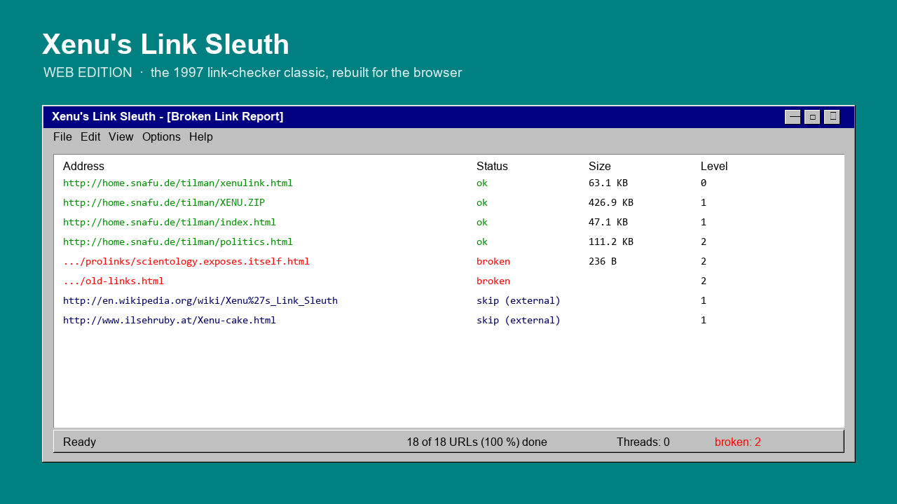
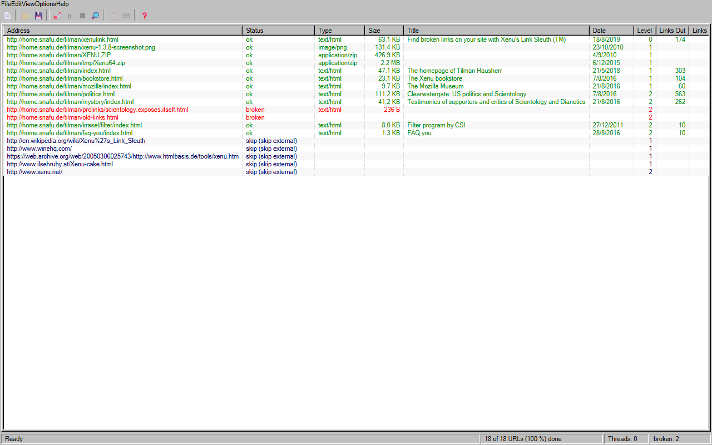

<div align="center">



# Xenu's Link Sleuth — Web Edition

**The 1997 link-checker classic, rebuilt for the browser. Same chrome, same spider, zero install.**

[](https://react.dev)
[](https://vitejs.dev)
[](https://nodejs.org)
[](LICENSE)
[](CONTRIBUTING.md)

*For SEO old-school folks and Win95 nostalgics. Built by reverse engineering the original
`Xenu.exe` 1.3.9 binary with [REA](https://github.com/morluto/rea) — menus, colors, INI keys,
error strings and report sections were extracted from the actual shipped binary and its CHM help.*

[Quick start](#-quick-start) · [Features](#-what-you-get) · [Architecture](#-architecture) · [Deployment](#-deployment) · [Known issues](#%EF%B8%8F-known-issues--limitations) · [Contributing](#-contributing)

</div>

---

## Why

[Xenu's Link Sleuth](http://home.snafu.de/tilman/xenulink.html) (Tilman Hausherr, 1997–2017) is
still the fastest, simplest broken-link checker ever made — and still used daily by SEOs.
But it is a 32-bit Windows MFC app: it doesn't run on macOS/Linux, can't be embedded in a
dashboard, can't be automated, and hasn't been updated since 2017.

This project rebuilds the **whole experience as a web app**: the exact Win95 list view, the
same 13 columns, the same status colors, the same crawl behavior — extracted from the binary
itself, not from memory.

<div align="center">



*Real crawl state: green ok / red broken / dark-blue skip, statusbar counters — pixel-faithful.*

</div>

## ✨ What you get

Everything below was **reverse engineered from `Xenu.exe` 1.3.9** (SHA-256
`fb4f14392ae3eb92f9b84da479fb6b55a09f1f1b466b8d681b353979da1f9630`): PE resources, string
tables, the CHM help file. The full extracted spec lives in
[`docs/xenu_spec.json`](docs/xenu_spec.json).

**UI (pixel-faithful Win95 chrome)**

- ListView with the exact 13 columns: Address, Status, Type, Size, Title, Date, Level, Links Out, Links In, Server, Error, Duration, Charset — sortable by clicking headers
- Xenu's exact status colors: ok `#008C00`, broken `#FF0000`, skipped `#000064`, not-tested `#606060`
- Menu bar (File/Edit/View/Options/Help) with the original items and shortcuts (Ctrl+N/O/B/R/T/G, F3, R, ALT-ENTER)
- Toolbar, status bar (`N of M URLs (x %) done`, `Threads: n`), MDI child window feel
- "Xenu's starting point" dialog: root URL, include/exclude prefixes, max depth, check-external
- Preferences dialog: Parallel Threads slider (1–100, default 30), Report section checkboxes, Advanced page (cookies, FailSimilarHosts, ExcludeMSO, retries, redirects-as-errors…)
- URL Properties dialog (Links on this page / Pages linking to this one)

**Spider engine (behavior-faithful)**

- BFS crawl by depth levels (default max 999, like the original)
- HEAD-first for known binary types (~35 extensions extracted from the binary), GET for HTML
- Redirects tracked and reported explicitly (`redirect: manual`), optional `RedirectIsError`
- Scheme skip list extracted from the binary (mailto:, tel:, steam:, ldap:, rtsp:, …)
- MSO junk exclusion (`/filelist.xml`, `/editdata.mso`, `/oledata.mso`)
- `FailSimilarHosts`: one dead host fails all its pending URLs at once (default on, like Xenu)
- Retry broken links (Ctrl+R) re-queues only failures — for temporary network errors
- Live URL extraction from: A, IMG, LINK, AREA, FRAME, IFRAME, EMBED, INPUT, BGSOUND, APPLET, OBJECT, BASE, META-REFRESH, STYLE (`@import`, `url()`), VIDEO, AUDIO, SOURCE, TRACK

**Reports & exports**

- HTML report with the original 9 sections: broken by link / by page, broken local, redirects, ftp-gopher, valid URLs, site map, statistics for managers (MIME table)
- Export TAB-separated file — with the **exact 16-column header extracted from the binary**
- Google Sitemap XML (`sitemap.xml`, sitemaps.org schema)
- GraphViz `.gv` directed graph of the crawl

**Bonus over the original**

- Runs on any OS with a browser; no Wine, no 32-bit pain
- Optional same-origin **crawl proxy** (`proxy/`) that removes CORS pain: per-host politeness limiter (≤6 concurrent), DNS/TLS error passthrough as real error text, SSRF guard, WAF-challenge detection
- `?demo=1` loads a sample crawl for screenshots and UI hacking


## 🔗 Live demo

- **Static demo (Hostinger):** <https://aliceblue-gerbil-404285.hostingersite.com/?demo=1>
  — UI fully working; live crawls limited to CORS-enabled targets (shared hosting has no Node proxy).
- **Full experience (proxy + any site):** run locally with `npm run dev`, or deploy `proxy/server.mjs`
  to any Node host / VPS.

## 🚀 Quick start

Prerequisites: **Node.js ≥ 18** (22+ recommended) and npm.

```bash
git clone https://github.com/acalero-shakers/xenu-link-sleuth-web.git
cd xenu-link-sleuth-web
npm install
npm run dev          # http://localhost:5173
```

1. Click the first toolbar button (or `Ctrl+N`) → *"Xenu's starting point"* dialog.
2. Enter a root URL → **OK**. The list fills live, exactly like the original.
3. Double-click any row → **URL Properties**. Press `R` → HTML report.
4. `File` menu → export TAB / Google Sitemap / GraphViz.

Open `http://localhost:5173/?demo=1` to see a populated list without crawling anything.

> **Note on what you can crawl:** in dev, the bundled proxy (`/xenu-proxy`) does the
> fetching server-side, so most public sites work out of the box. Without the proxy
> (pure static hosting) you can only crawl CORS-enabled targets. See [Deployment](#-deployment).

The proxy blocks requests to private/loopback addresses by default — set
`XENU_ALLOW_PRIVATE=0` to allow them for local testing.

## 🏗 Architecture

```
┌────────────────────────────  browser  ────────────────────────────┐
│  React UI (Win95 chrome)                                          │
│    MenuBar / Toolbar / LinkListView / Dialogs / StatusBar         │
│         │ state: records Map + stats                              │
│  ┌──────▼──────────────────────────────┐                          │
│  │ engine/crawler.js  (XenuCrawler)    │  BFS queue, per-host     │
│  │  - classify (scheme/ext/internal)   │  semaphore, redirect     │
│  │  - fetch via /xenu-proxy            │  tracking, backlinks     │
│  │  - DOMParser link extraction        │                          │
│  ├──────▼──────────────┐                  │                          │
│  │ engine/report.js    │  report builder, TAB/Sitemap/GraphViz exports
│  └─────────────────────┘                  │                          │
└───────────────────────┬───────────────────────────────────────────┘
                        │ same-origin GET /xenu-proxy?url=…
┌───────────────────────▼───────────────────────────────────────────┐
│  proxy/core.mjs (vite plugin in dev / node server.mjs in prod)    │
│    - real server-side fetch (no CORS)                             │
│    - per-host politeness (≤6 concurrent, env XENU_PER_HOST)       │
│    - DNS/TLS failures → 502 + x-xenu-error (real cause text)      │
│    - SSRF guard: blocks loopback/private ranges by default        │
│    - WAF detection: passes cf-mitigated as x-xenu-waf             │
│    - 8 MB body cap, 65 s timeout, HEAD/GET only                   │
└───────────────────────────────────────────────────────────────────┘
```

The crawler never talks to target sites directly when a proxy is present — one `?ping=1`
probe decides. All reverse-engineering evidence and the extracted spec are in [`docs/`](docs/).

## 📦 Deployment

**Vercel (recommended for this repo):** Vite static build + serverless `/xenu-proxy`
(`api/xenu-proxy.js`, rewritten in `vercel.json`). Same crawl path as local dev.
Function `maxDuration` is 60s (plan may cap lower — Hobby is 10s). Optional project
env: `XENU_PER_HOST`, `XENU_TIMEOUT_MS`, `XENU_UA`, `XENU_ALLOW_PRIVATE`.

**Static only (no proxy — CORS-limited crawling):**

```bash
npm run build     # dist/ → any static host (nginx, Pages, …)
```

**With Node proxy (VPS / Docker):**

```bash
npm run build
node proxy/server.mjs 8080    # serves dist/ AND /xenu-proxy on one port
```

Put it behind nginx/Caddy with TLS as usual. Useful env vars:

| Var | Default | Meaning |
|---|---|---|
| `XENU_PER_HOST` | `6` | max concurrent requests per target host (politeness) |
| `XENU_TIMEOUT_MS` | `65000` | upstream fetch timeout |
| `XENU_UA` | current Chrome | User-Agent sent to targets |
| `XENU_ALLOW_PRIVATE` | unset (guard on) | set `0` to **allow** private/loopback; leave unset/other to **block** (SSRF) |

Keep the SSRF guard on for any multi-user/public deployment (do not set `XENU_ALLOW_PRIVATE=0`).

**Docker (sketch):**

```dockerfile
FROM node:22-alpine
WORKDIR /app
COPY package*.json ./
RUN npm ci
COPY . .
RUN npm run build
EXPOSE 8080
CMD ["node", "proxy/server.mjs", "8080"]
```

## ⚠️ Known issues & limitations

Honest list — the original was reverse engineered, not magically perfected:

| Issue | Status | Notes |
|---|---|---|
| JS-rendered links (SPAs) not seen | by design (same as Xenu 1.3.9) | fetch sees raw HTML only; a headless-browser mode is the fix |
| No `.xen` save/open | missing | the original's binary format is undocumented; JSON export planned |
| Orphan search (FTP) impossible | by design | browsers speak no raw FTP; would need server-side FTP walker |
| `SessionIdRegEx` not implemented | **missing** | sites that put session IDs in every link explode the URL count; the original had a regex filter in its INI. High-priority contribution |
| No max-URLs guard | **missing** | calendars/faceted filters can balloon memory; hard cap planned |
| WAF challenge pages can fake "200 ok" | partial | `cf-mitigated` is surfaced, other WAFs need signatures |
| HTTP-auth / form login | not supported | same as the original (its workaround: log in with IE first) |
| Browser caps concurrency at ~6/host | by design | HTTP/1.1 connection limit; `Threads: 30` is a politeness setting, not true parallelism |
| HEAD unsupported by some servers | known | some reply 405 to HEAD → false broken; GET-retry planned |
| Rate limiting / IP bans | real-world | lower `XENU_PER_HOST`, respect robots.txt (checker not yet implemented), crawl off-peak |
| Some hosts RST datacenter TLS handshakes | environmental | e.g. example.com from some networks; retry or change egress |

**Legal/ethical:** crawl only sites you have permission to crawl. Respect `robots.txt`
(checker not yet implemented — planned). The name "Xenu's Link Sleuth" and the original
program belong to Tilman Hausherr; this is an independent reimplementation for
interoperability and preservation, not affiliated with or endorsed by him. Please buy him
a T-shirt if you see him. (Read the original FAQ. You'll understand.)

## 🤝 Contributing

PRs welcome — this is a nostalgia project with real users (SEOs who miss the tool).
Read [`CONTRIBUTING.md`](CONTRIBUTING.md) for setup, code style and the reverse-engineering
workflow (how to extract new behavior from the original binary with REA).

Good first issues:

1. `SessionIdRegEx` filter (spec: strip `;jsessionid=…` style suffixes before enqueueing)
2. Max-URLs safety cap + "URL space too large" warning
3. HEAD→GET fallback on 405
4. `robots.txt` awareness (on/off toggle, default off to stay Xenu-faithful)
5. Save/Open session as `.xen.json`
6. i18n (the binary's German resources in `.rsrc/1031` are your reference)

## 📜 License & credits

Code: **MIT** — see [LICENSE](LICENSE).

- **Tilman Hausherr** — creator of the original Xenu's Link Sleuth (1997–2017). This project exists because his tool is a masterpiece of software simplicity.
- **[REA — Reverse Engineer Anything](https://github.com/morluto/rea)** — the MCP toolkit used to extract menus, dialogs, strings and behavior from the shipped binary.
- The original's docs (CHM), FAQ and `whatsnew.txt` — reproduced as facts, not text, in `docs/xenu_spec.json`.

*Xenu's Link Sleuth™ is a trademark of Tilman Hausherr. This project is a functional
reimplementation for interoperability/preservation; it contains no original code.*
